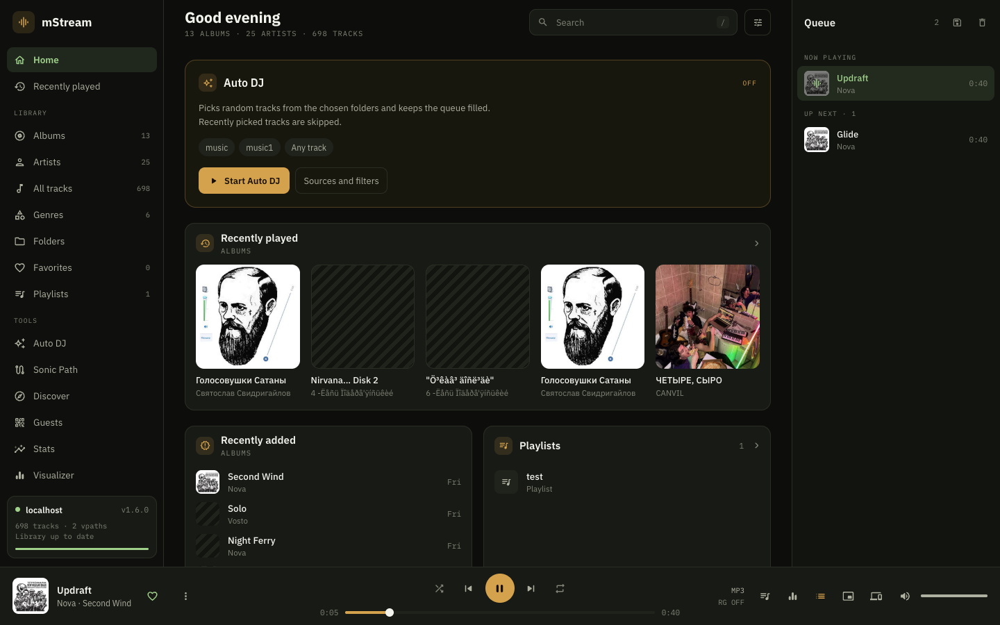
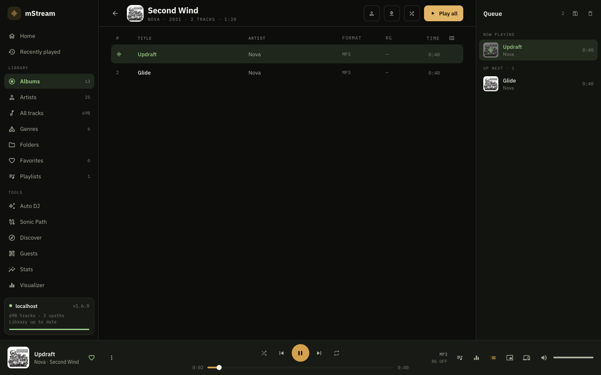
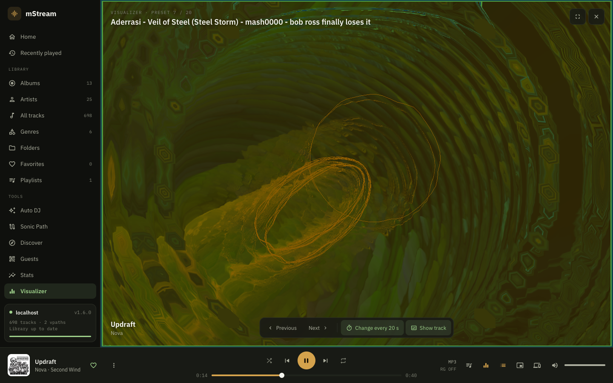
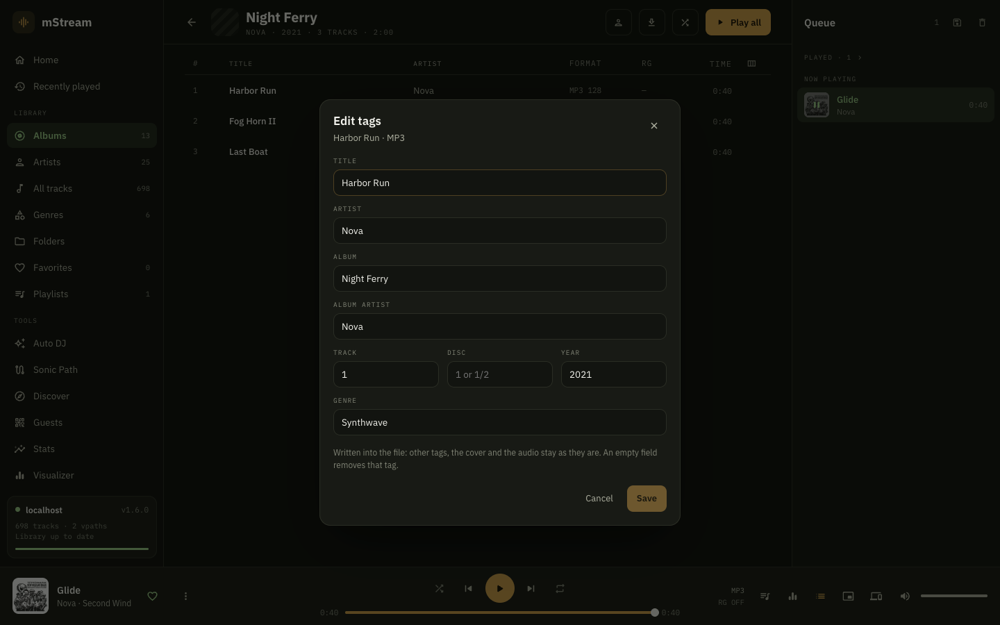
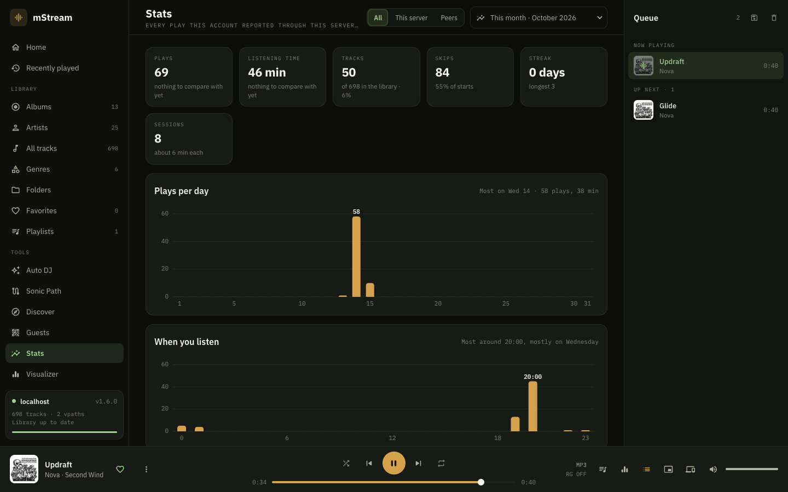
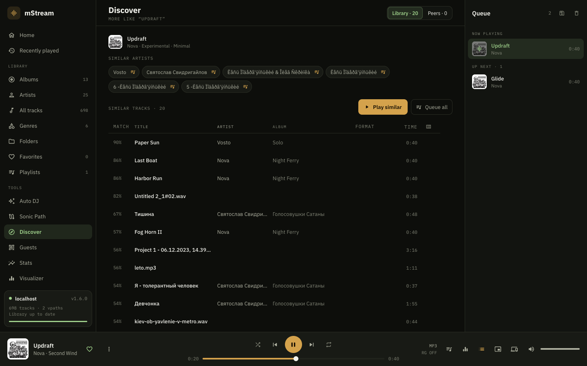
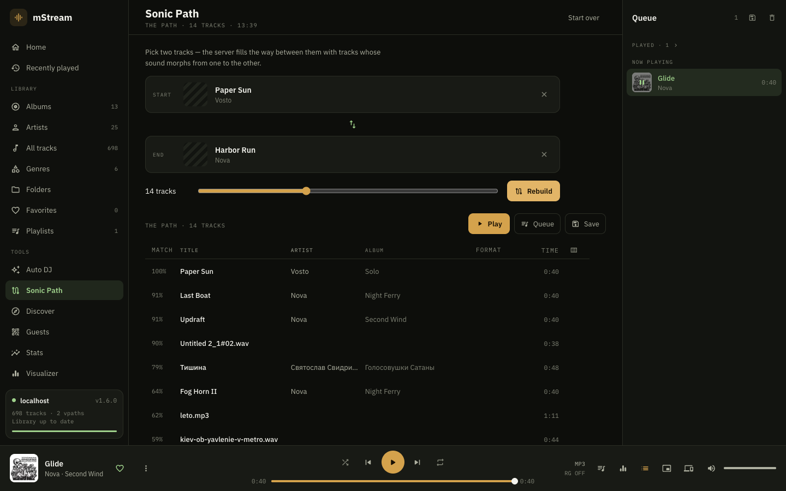
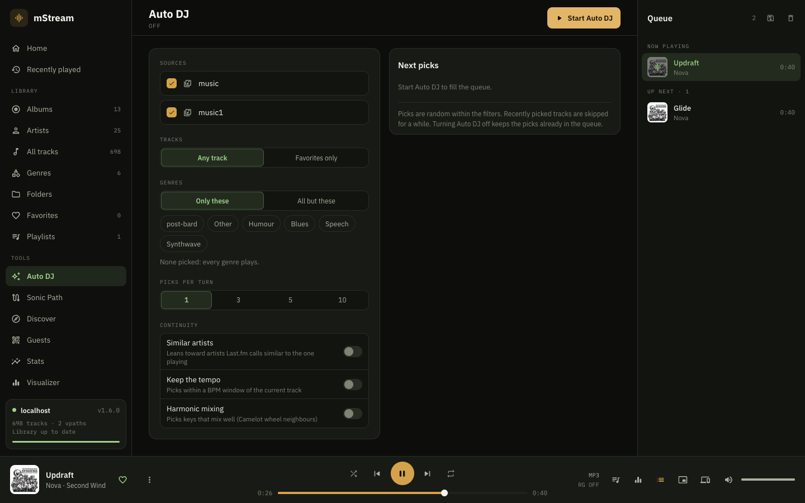
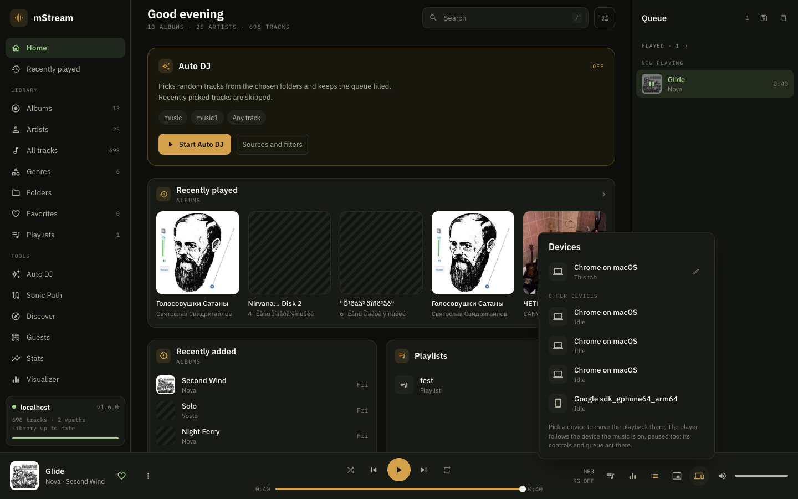
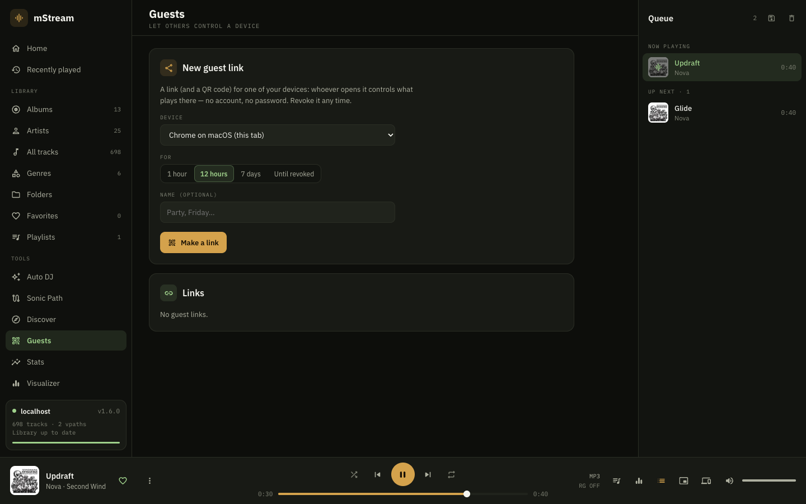

# mStream · Zenelo fork

A self-hosted music server: point it at your music folders and listen from any browser, from the
[Zenelo](https://github.com/ewoxej/zenelo) Android app, or from the server's own speakers.

This is the [Zenelo](https://github.com/ewoxej/zenelo) fork of [mStream](https://github.com/IrosTheBeggar/mStream).
Everything upstream has stays; the web player is new (restyled after the Zenelo app), and so are a number of
server features — playback devices, guests, tag editing, single sign-on, the server's speakers as a device and
more.



## The web player

- **Your library, any way you like**: albums, artists, genres, all tracks, folders, favorites, playlists,
  recently played and added, search. Track tables with the columns you choose (format, ReplayGain, BPM, key,
  plays…). The track list is kept in the browser, so a big library opens at once.
- **Gapless-feeling playback**: the next tracks of the queue are fetched ahead, so nothing stalls between them.
  Transcoding when you want it, synced lyrics, ReplayGain.
- **A visualizer**: 20 Milkdrop presets (butterchurn), picked for reacting to the beat and driven by the music.
- **Tags** of a track edited from its ⋮ menu, written into the file.
- **Stats**: plays, listening time, streaks, when you listen and what.

| | |
|---|---|
|  |  |
|  |  |

## What the server hears

The server analyses how your music sounds (embeddings, BPM, key) and uses it:

- **Auto DJ** keeps the queue going with tracks that fit: chosen libraries, genres, a length window, similar
  artists, the tempo, harmonic mixing (Camelot neighbours).
- **Sonic Path**: pick two tracks, and the server fills the way between them with tracks whose sound morphs from
  one to the other.
- **Discover**: more like what plays — from your library, from your federated peers (play their tracks, copy
  them into your library), and from the discovery network (other servers' music you don't have yet, with
  plug-ins to get it).

| | |
|---|---|
|  |  |
|  | |

## Devices and guests

- **Playback devices**, Spotify Connect–style: every browser tab and Zenelo phone signed in to your account is a
  device. See what each plays, move playback between them, and control one from another.
- **The server's speakers** are a device too, for admins and users allowed server audio (in Docker: a Linux host
  with a sound device, see [docker/README.md](docker/README.md)).
- **Guests**: a link or a QR code lets someone without an account control one device — see what plays, search,
  queue, skip, set the volume. Links last an hour, 12 hours, a week, or until revoked.

| | |
|---|---|
|  |  |

## Server

- **Single sign-on** (OpenID Connect: Authelia, Authentik, Keycloak…): optional or required, access and admin
  groups, straight to the provider if you like. The Zenelo app signs in through it too.
- **Tag editing API**: `POST /api/v1/tags/read` / `tags/write` (mp3, flac, m4a, ogg, opus) — ffmpeg rewrites the
  tags with the audio and the cover copied as they are; ratings and plays follow the file.
- **The library sync manifest** the Zenelo app mirrors, so a phone keeps the whole library without asking for it
  page by page.
- From upstream: federation with other mStream servers, the discovery network, DLNA, transcoding, album art and
  lyrics lookup, backups, a torrent client and yt-dlp, an admin panel. The API is described in
  [docs/openapi.yaml](docs/openapi.yaml).

## Run it

With Docker (linux/amd64, linux/arm64):

```sh
docker run -d --name mstream -p 3000:3000 \
  -v mstream-config:/config \
  -v /path/to/music:/music:ro \
  ghcr.io/ewoxej/mstream-zenelo:latest
```

Then open `http://<host>:3000/admin` and add a user (until there is one, the server has no login). Compose,
more libraries, the server's speakers and upgrading: [docker/README.md](docker/README.md).

From source (Node.js 22.5 or newer):

```sh
npm ci
npm start
```

The server listens on port 3000; `save/conf/default.json` (or the admin panel) holds the configuration. Releases
of this fork are tagged `zenelo-v<version>`; the admin panel says when a newer one is out. Upstream's binaries and
install scripts install upstream mStream, not this fork.

## Credits

[mStream](https://github.com/IrosTheBeggar/mStream) by Paul Sori and its contributors, on which this is built;
[music-metadata](https://github.com/Borewit/music-metadata), [Lofty](https://github.com/Serial-ATA/lofty-rs),
[Symphonia](https://github.com/pdeljanov/Symphonia), [Butterchurn](https://github.com/jberg/butterchurn),
[Essentia.js](https://mtg.github.io/essentia.js/) and [LRCLIB](https://lrclib.net/).

Licensed under the GPL-3.0, as upstream (see [LICENSE](LICENSE)).
